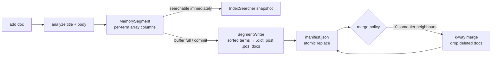

# minisearch design notes

This document specifies the on-disk index format byte by byte, and explains
the segment and merge strategy plus the invariants that keep the index
correct. The README covers the higher-level "what and why".

- [1. Index layout](#1-index-layout)
- [2. Common file framing](#2-common-file-framing)
- [3. Integer encodings](#3-integer-encodings)
- [4. Term dictionary (`.dict`)](#4-term-dictionary-dict)
- [5. Postings (`.post`) and skip tables](#5-postings-post-and-skip-tables)
- [6. Positions (`.pos`)](#6-positions-pos)
- [7. Document store (`.docs`) and ids (`.ids`)](#7-document-store-docs-and-ids-ids)
- [8. Deletions (`_N.del`)](#8-deletions-_ndel)
- [9. Manifest and atomic commits](#9-manifest-and-atomic-commits)
- [10. Write path: buffer, flush, merge](#10-write-path-buffer-flush-merge)
- [11. Merge policy](#11-merge-policy)
- [12. Read path and snapshots](#12-read-path-and-snapshots)
- [13. Invariants (and the tests that guard them)](#13-invariants-and-the-tests-that-guard-them)
- [14. Format trade-offs and alternatives considered](#14-format-trade-offs-and-alternatives-considered)

---

## 1. Index layout

An index is a directory:

```
indexes/wiki/
├── manifest.json          ← the only mutable file; names the live segments
├── seg_000012.dict        ← term dictionary
├── seg_000012.post        ← doc IDs + term frequencies, with skip tables
├── seg_000012.pos         ← positions
├── seg_000012.docs        ← doc lengths, stored fields (title/url/body)
├── seg_000012.ids         ← external document ids (JSON list)
├── seg_000012_3.del       ← deletion bitmap, generation 3 (optional)
└── seg_000013.*           ← another segment
```

A **segment** is an immutable mini-index over a contiguous run of documents.
Segment files are written once, fsync'd, and never modified. The only things
that change over time are which segments the manifest lists, and the
deletion bitmaps, which are new files with a higher generation number.

Doc IDs inside a segment are **local** (`0 … max_doc-1`). The global ID of a
document is `doc_base + local`, where `doc_base` is the sum of `max_doc` over
the segments before it in manifest order. `doc_base` is computed when the
index is opened, never stored. That is what lets a merge drop deleted
documents (compacting IDs) without rewriting any other segment.

## 2. Common file framing

Every binary file is `header | payload | footer`:

```
offset  size  field
0       4     magic       b"MSRC"
4       4     kind        b"DICT" | b"POST" | b"POSN" | b"DOCS"
8       2     version     u16 little-endian, currently 1
10      1     codec       u8: 1 = VByte with d-gaps, 0 = raw uint32 (baseline)
11      5     reserved    zero
16      …     payload
…       …     footer      file-specific trailer
end-4   4     crc32       u32 LE, CRC-32 of every preceding byte (header included)
```

Opening a segment checks magic, kind and version (a cheap check that catches
mixed-up or foreign files). The full CRC check reads every byte, so it runs
on demand (`SegmentFiles(..., verify=True)`), not on every open. **Offsets
inside a file are relative to the end of the 16-byte header.**

## 3. Integer encodings

**VByte.** Seven payload bits per byte, low group first. The high bit set
means "more bytes follow":

```
5        → 05
127      → 7F
128      → 80 01
300      → AC 02          (300 = 0b10_0101100 → 0101100|1, 0000010|0)
16384    → 80 80 01
```

**D-gaps.** Sorted sequences are stored as differences. Doc IDs
`[3, 7, 8, 20]` become `[3, 4, 1, 12]`. Frequent terms have small gaps, and
small numbers fit in one VByte byte.

**Positions** are gap-encoded *per document*. The gap resets at every
document boundary: positions `[3, 7, 9 | 2, 5]` with tfs `[3, 2]` are stored
as `[3, 4, 2 | 2, 3]`.

The **raw codec** (`codec = 0`) stores the same streams as fixed `u32` with
absolute values (no gaps). It exists only as the uncompressed baseline for
the size benchmark: same structure, so the comparison is fair.

Two implementations of VByte exist: a reference loop (`vbyte_encode_py`,
`vbyte_decode_py`) and a numpy-vectorised one. Tests check that they produce
identical bytes on random inputs. The vectorised decoder finds value
boundaries (`byte < 0x80`), shifts each 7-bit group by `7 × index_in_value`,
and sums the groups with `np.add.reduceat`. Disjoint bit fields make the sum
equal to bitwise OR.

## 4. Term dictionary (`.dict`)

Terms are sorted by code point (identical to UTF-8 byte order) and grouped
into **blocks of 16**. Each block is front-coded: every term stores only the
suffix that differs from the previous term.

```
payload:
  block 0
  block 1
  …
  sparse index
footer:
  u64 LE  index_offset     (payload offset of the sparse index)
  u64 LE  num_terms
  u32 LE  crc32

block:
  vbyte  count             (≤ 16)
  vbyte  post_start        (.post payload offset of the block's first term)
  vbyte  pos_start         (.pos  payload offset of the block's first term)
  count × entry

entry:
  vbyte  shared            (bytes shared with the previous term; 0 for the first)
  vbyte  suffix_len
  bytes  suffix            (UTF-8)
  vbyte  df                (documents containing the term)
  vbyte  cf - df           (collection frequency minus df: always ≥ 0, usually tiny)
  vbyte  max_tf            (largest tf in the postings: WAND upper bound)
  vbyte  min_dl            (shortest doc length in the postings: WAND upper bound)
  vbyte  post_len          (bytes of this term in .post)
  vbyte  pos_len           (bytes of this term in .pos)

sparse index:
  vbyte  num_blocks
  num_blocks × { vbyte len, bytes first_term, vbyte block_offset }
```

Postings offsets are not stored per term. They are rebuilt by summing
`post_len` from the block's `post_start`, which saves 2 integers per term.

**Lookup:** binary search the in-memory list of block first terms, decode
that one block (≤ 16 entries, cached in a 4,096-block LRU), then binary
search inside it. **Prefix scans** (`comput*`) start at the block that
could hold the prefix and decode forward until terms stop matching. Only
1/16 of the vocabulary lives in RAM. For the 100k-article index (384,530
terms), the dictionary file is 4.8 MB.

## 5. Postings (`.post`) and skip tables

Each term's postings are split into **blocks of 128 documents**:

```
term region in .post:
  [skip table]   only if nblocks > 1
  block 0
  block 1
  …

skip table: nblocks × { u32 last_doc, u32 post_rel, u32 pos_rel }   (12 bytes/block, LE)
  last_doc  = last local doc ID in the block
  post_rel  = offset of the block's data, relative to the end of the skip table
  pos_rel   = offset of the block's positions, relative to the term's .pos region

block (n = 128, or the remainder for the last block):
  n × vbyte  doc gaps
  n × vbyte  tfs
```

`nblocks = ceil(df / 128)` is known from the dictionary, so the reader knows
whether a skip table exists and how large it is. Single-block terms carry no
skip table: in the 100k index only 7,817 of 384,530 terms (2%) have df > 128,
and skip tables take 3.5% of `.post`.

**Gaps continue across blocks.** The first gap of block *k* is relative to
the last doc of block *k−1* (the first block is relative to 0). That gives
two access paths over the same bytes:

- **Whole-term decode** (vectorised engine): decode the entire region in one
  `vbyte_decode` call, reshape `[gaps₀ tfs₀ gaps₁ tfs₁ …]` into doc-gap and
  tf columns, and run one `cumsum`. No per-block Python loop.
- **Random access** (DAAT engine): `advance(target)` binary-searches the
  skip table's `last_doc` column, jumps to `post_rel`, decodes that single
  block, and adds the previous block's `last_doc` as the base. Blocks jumped
  over are never decompressed.

## 6. Positions (`.pos`)

```
term region in .pos:
  block 0 positions   (for each doc of block 0, tf gap-encoded positions)
  block 1 positions
  …
```

Positions live in their own file so that non-phrase queries never read
them. A term's positions are decoded lazily, all at once, then split with
the cumulative sum of tfs. Within a document, positions count *raw tokens*,
including removed stopwords. "university of london" stores
`univers@0, london@2`, and a phrase query compares relative offsets.

Title and body share one indexed field. Body positions start at
`len(title_tokens) + 100`, so a phrase can never match across the
title/body boundary (tested).

## 7. Document store (`.docs`) and ids (`.ids`)

```
payload:
  u64        n
  n   × u32  doc_lengths       (indexed tokens per doc: the BM25 |d|)
  n+1 × u64  blob offsets      (relative to the first blob)
  blobs      zlib(JSON {"id","title","url","body"}) per doc
```

`doc_lengths` and the offset table are used as **numpy views directly on the
mmap** (`np.frombuffer`), with no copy and no parse. Each document is
compressed on its own, so fetching one hit for a snippet decompresses one
blob. Compressing blocks of 16 documents together would save 12.9% (measured
on the first 5,000 articles), at the cost of decompressing 16 documents per
hit.

`.ids` is a JSON list of external ids, loaded at open to rebuild the
`external id → (segment, local)` map that deletes and updates need.

## 8. Deletions (`_N.del`)

A delete never touches segment files. It flips a bit in an in-memory
deletion set. On commit, the segment's full bitmap is written as
`seg_X_<gen+1>.del` (`np.packbits`, 1 bit per doc), and the manifest
records the new `del_gen`. Old generations become orphans and are garbage
collected.

Deleted documents still count towards `df` until their segment is merged,
as in Lucene. The ranker clamps `df ≤ N`, so IDF can never go negative (a
bug the WAND equivalence tests caught). A merge drops the deleted documents
and makes `df` exact again. A test checks that a merged index scores
identically to a fresh index of the survivors.

## 9. Manifest and atomic commits

```json
{
 "version": 1,
 "generation": 15,
 "codec": "vbyte",
 "analyzer": {"lowercase": true, "fold_accents": true, "stopwords": "lucene",
              "stemmer": "porter", "min_length": 1, "max_length": 40},
 "next_segment": 11,
 "segments": [
  {"name": "seg_000010", "max_doc": 100000, "num_terms": 384530,
   "total_length": 19047838, "codec": "vbyte", "del_gen": 0, "num_deleted": 0,
   "file_sizes": {"post": 25739789, "pos": 30353688, "dict": 4995592, "docs": 85309211, "ids": 1473130},
   "raw_postings_bytes": 163109816}
 ]
}
```

**Commit protocol:**

1. Write all new segment files and deletion bitmaps, then `fsync` each.
2. Write `manifest.json.tmp`, then `fsync` it.
3. `os.replace(tmp, manifest.json)`: an atomic rename on POSIX and Windows.
4. `fsync` the directory, so the rename itself is durable.

A crash before step 3 leaves the old manifest, and the new files are
orphans. A crash after it leaves the new manifest, whose files are all
durable. There is no state in which the manifest names a half-written file.
On open, every file the manifest does not reference is deleted.

The **analyzer configuration is part of the manifest**. Reopening the index
with a different analyzer raises an error, because queries must be analysed
exactly like the documents they are matched against.

## 10. Write path: buffer, flush, merge



- **Buffer.** `MemorySegment` keeps, for every term, three `array('I')`
  columns: local doc IDs, tfs, and flat positions. Switching from Python
  lists of ints (~36 bytes per value) to 4-byte columns cut indexing memory
  2.6× and made indexing 30% faster, since a flush writes these columns
  directly.
- **Flush** happens at `max_buffered_docs` (10,000 by default) or on
  `commit()`. Terms are written in sorted order. Lists shorter than 24
  values use pure-Python encoding, because numpy's per-call overhead
  dominates below that.
- **Merge** = k-way merge of the input dictionaries with a heap. For each
  term: decode the postings in each segment that has it, remap local doc
  IDs through `remap[local] → new local | -1` (deleted), filter, and
  concatenate. Inputs are adjacent and remapping preserves order, so the
  output is sorted with no sort step. Stored-field blobs are copied as
  compressed bytes.

## 11. Merge policy

Logarithmic tiers (similar to Lucene's `LogMergePolicy`):

```
tier(segment) = floor(log_F(live_docs / min_segment_docs))    F = merge_factor = 10
```

When **F adjacent segments share a tier**, they are merged into one segment
of the next tier. Segments where more than 30% of the docs are deleted are
also rewritten, on their own, to reclaim space.

- **Write amplification:** each document is rewritten about
  `log_F(N / flush_size)` times. For 100k docs flushed 10k at a time, that
  is one merge: the ten 10k-doc segments merge into one 100k-doc segment,
  which is why the benchmark reports a single segment before force-merge.
  Total merge cost is O(N log N).
- **Read amplification:** at most F−1 segments per tier, so
  O(F · log_F N) segments in total. Global statistics make the number of
  segments invisible to scoring. A test checks that 12 flushed and merged
  segments rank identically to a single bulk build.
- **Why only adjacent segments?** Doc IDs stay in insertion order across the
  index, so merged postings are a plain concatenation, and the global doc-ID
  space stays contiguous. Lucene's `TieredMergePolicy` merges non-adjacent
  segments to pick cheaper merges, at the cost of doc-ID order. Future work.

## 12. Read path and snapshots

- `SegmentFiles` owns the mmaps, the sparse term index, the doc-length view
  and the block cache. There is one per segment, and it is never mutated.
- `DiskSegment` is a cheap **immutable view**: `(files, doc_base, deleted)`.
  A delete or a merge creates new views (copy-on-write) instead of changing
  existing ones.
- `Index.searcher()` returns an `IndexSearcher` over the current views plus a
  frozen snapshot of the memory buffer (the first *n* buffered docs; postings
  only grow by appending, so the prefix is stable). A query sees one
  consistent point in time, however many writes happen during it (tested).
- **Global statistics** (N, avgdl, df) are summed over the snapshot's
  segments. Scoring each segment with its own statistics would make results
  depend on merge timing.

## 13. Invariants (and the tests that guard them)

| Invariant | Guarded by |
|---|---|
| Disk postings, positions and term stats equal the in-memory ones exactly, for both codecs | `test_storage.py::test_disk_segment_matches_memory_segment` |
| Skip-table block decoding equals slices of the whole-term decode; `last_doc` is correct | `test_block_decoding_with_skip_table` |
| VByte: reference and vectorised versions produce identical bytes; round-trip over 0…2⁶³−1 | `test_codecs.py` |
| Incremental (flush + merge) ranking equals a bulk build | `test_incremental_indexing_creates_segments_and_merges` |
| Merging with deletes expunged scores like a fresh index of the survivors | `test_deletes_updates_and_merge_expunge` |
| A searcher snapshot never changes after later writes | `test_snapshot_isolation` |
| Multi-segment scores equal single-segment scores (global stats) | `test_ranking.py::test_global_stats_across_segments` |
| WAND = exhaustive DAAT = vectorised, on random queries and three rankers | `test_query.py::test_wand_equals_exhaustive_on_random_or_queries` |
| Boolean, phrase and wildcard results equal a brute-force scan | `test_boolean_phrase_wildcard_match_oracle`, `test_random_boolean_queries_match_oracle` |
| A flipped byte is detected; files no manifest references are removed | `test_corruption_is_detected`, `test_orphan_files_are_garbage_collected` |

## 14. Format trade-offs and alternatives considered

| Decision | Chosen | Alternative | Why |
|---|---|---|---|
| Integer codec | VByte + d-gaps (2.92× on postings) | PForDelta / Simple-8b / Elias-γ | VByte is byte-aligned and simple to vectorise. Bit-level codes compress tighter, but decoding them is slow without SIMD or C. |
| Block size | 128 docs | 64 / 256 | Lucene's choice. Small enough that a skip lands near the target, large enough that skip tables cost only 3.5% of `.post` (12 bytes per block). |
| Dictionary | Sorted array, front-coded blocks of 16, sparse index in RAM | Hash table; FST (Lucene); trie | Sorted order gives prefix and range scans for free. Front coding shrinks the 384k-term vocabulary to 4.8 MB. An FST would also share suffixes, but it is far more complex. |
| Positions | Separate file, lazily decoded | Interleaved with doc IDs | Most queries never need positions. Positions are 54% of the compressed postings, so term-only queries read less than half the data. |
| Stored fields | zlib per doc | Block compression; no store | O(1) random access for snippets. 16-doc blocks would be 12.9% smaller but decompress 16 docs per hit. |
| Deletes | Tombstone bitmaps + merge | Rewrite segments in place | Immutability makes commits atomic and readers lock-free. |
| Concurrency | One writer (lock), snapshot readers | Multi-writer | Matches the immutable-segment design. The single API process serialises writes. |
