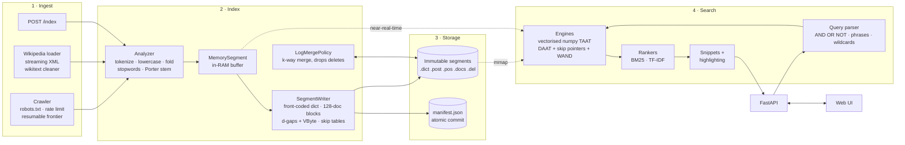
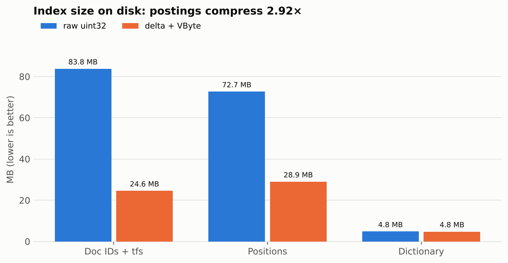
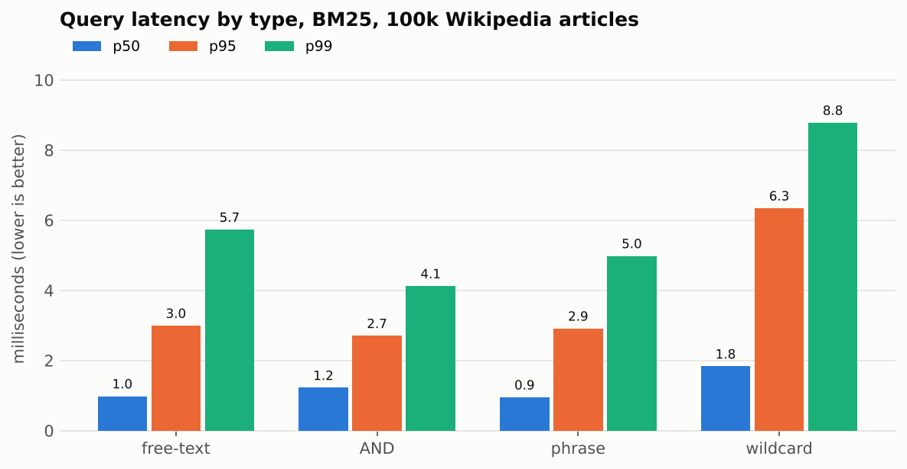
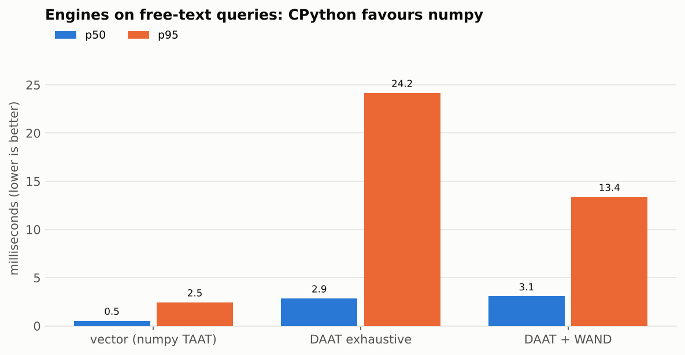
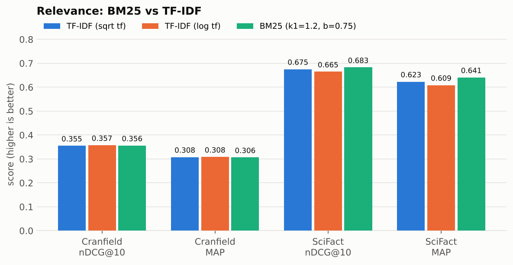
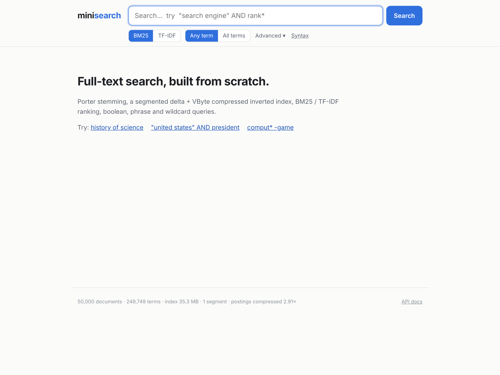
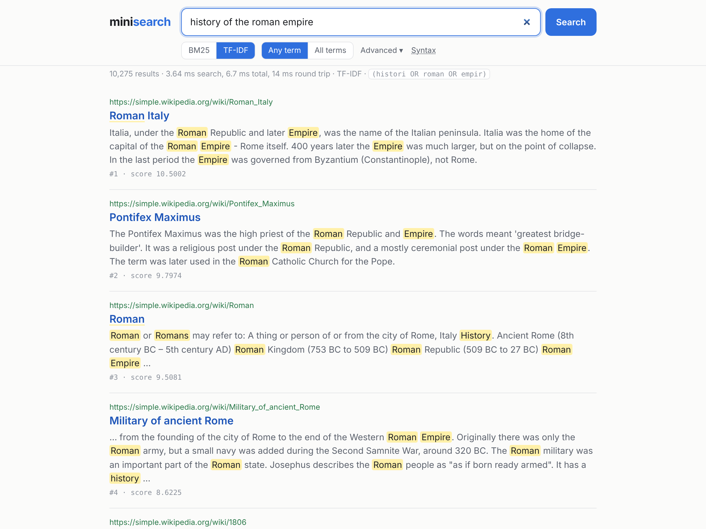
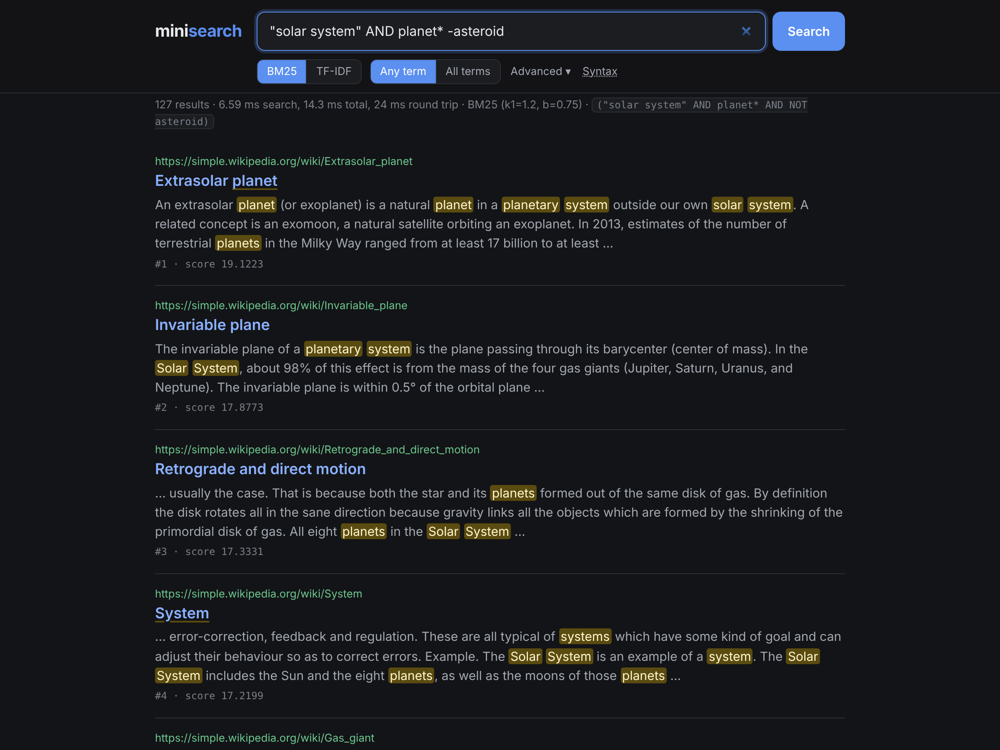
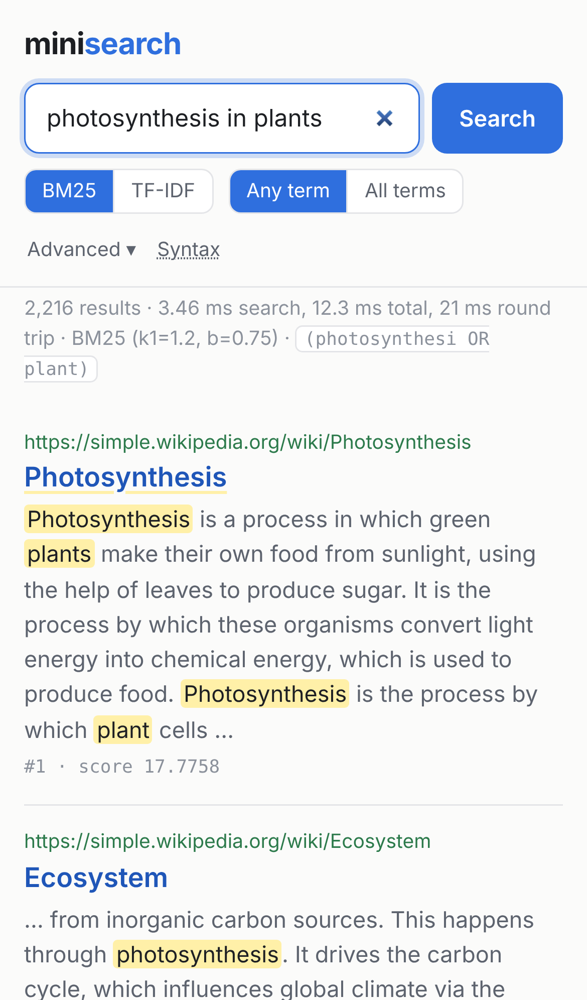

# minisearch

**A full-text search engine built from scratch in Python.** It has a Porter
stemmer, a segmented on-disk inverted index with delta + VByte compression,
skip pointers, BM25 and TF-IDF ranking, a boolean/phrase/wildcard query
engine with WAND top-K, a polite web crawler, a FastAPI backend and a web UI.
It is benchmarked on 100,000 Wikipedia articles and evaluated against human
relevance judgments.

The core (tokenizer, stemmer, inverted index, compression, storage format,
ranking, query parser and executor) is hand-written. No Lucene, Elasticsearch,
Whoosh or any other search library. Dependencies are limited to the standard
library, numpy, FastAPI, httpx and BeautifulSoup.


## Results at a glance

| | |
|---|---|
| **Scale** | 100,000 Simple English Wikipedia articles · 19.0M tokens · 384,530 distinct terms |
| **Indexing** | **825 docs/s** (157k tokens/s), single thread, including flushes and merges |
| **Compression** | postings **156.4 MB → 53.5 MB (2.92×)** with d-gaps + VByte. The inverted index is 38% of the source text. |
| **Query latency** | 1,000 queries: **p50 1.06 ms · p95 3.41 ms · p99 6.39 ms** (~700 queries/s on one thread) |
| **Memory** | index opens in 57 ms at **58 MB RSS** (postings are memory-mapped) |
| **Relevance** | SciFact BM25 **nDCG@10 = 0.683** (published BEIR BM25 baselines: 0.665–0.679). Cranfield nDCG@10 = 0.356 |
| **Tests** | 231 tests, including brute-force oracles, hand-computed BM25 and randomised engine-equivalence checks |

## Contents

- [Architecture](#architecture)
- [How the inverted index works](#how-the-inverted-index-works)
- [How ranking works: TF-IDF and BM25](#how-ranking-works-tf-idf-and-bm25)
- [Query engine](#query-engine)
- [Crawler](#crawler)
- [Design decisions and trade-offs](#design-decisions-and-trade-offs)
- [Setup](#setup)
- [API](#api)
- [Benchmarks](#benchmarks)
- [Relevance evaluation](#relevance-evaluation)
- [Screenshots](#screenshots)
- [Testing](#testing)
- [Bugs found along the way](#bugs-found-along-the-way)
- [Future work](#future-work)

## Architecture



```
src/minisearch/
├── analysis/      tokenizer, analyzer pipeline, Porter stemmer, stopwords
├── indexer/       Index facade, in-memory segment, merge policy and k-way merge
├── storage/       codecs (VByte, d-gaps), segment writer and reader (mmap), manifest
├── ranking/       Ranker interface, BM25, TF-IDF
├── query/         parser, vectorised engine, skip-pointer iterators, WAND, wildcards
├── snippets/      query-biased snippet selection and highlighting
├── crawler/       frontier, robots.txt, fetcher, HTML extraction
├── datasets/      Simple English Wikipedia loader
├── evaluation/    P@k, R@k, MAP, nDCG, MRR, significance test, Cranfield/BEIR loaders
├── api/           FastAPI app
├── ui/            static HTML/CSS/JS (no build step)
└── cli.py         minisearch index | search | stats | merge | serve | wiki | crawl
benchmarks/        run_benchmarks.py, evaluate.py, charts.py, results/
tests/             one test module per component
```

[DESIGN.md](DESIGN.md) specifies the on-disk format byte by byte, plus the
segment and merge strategy.

## How the inverted index works

An **inverted index** maps each term to its **postings list**: the documents
that contain it, how often (term frequency), and at which positions.

```
"search"  →  doc 3 (tf 2, pos [4, 17]),  doc 7 (tf 1, pos [0]),  doc 12 (tf 1, pos [9]) …
```

**1. Analysis.** Text becomes terms through a configurable pipeline:
tokenize → lowercase → fold accents → drop stopwords → **Porter stem**. The
stemmer is implemented from the 1980 paper and cross-checked against NLTK's
implementation of the original algorithm (0 mismatches on 1,973 words).
Positions are counted *before* stopwords are dropped. "University of
London" becomes `univers@0, london@2`, so phrase queries still line up even
though "of" is never indexed. The analyzer config is saved in the index, and
queries are always analysed identically.

**2. Segments.** New documents go into an in-memory buffer, which is already
searchable. Every 10,000 docs (or on `commit()`) the buffer is written to
disk as an **immutable segment**. Immutability is what makes commits
atomic, readers lock-free and caching trivial. Updates are delete + re-add.
Deletes are tombstone bitmaps, and the space is reclaimed when segments
merge.

**3. Compression.** Postings are split into blocks of 128 documents. Doc
IDs are stored as **gaps** (`[3, 7, 8, 20] → [3, 4, 1, 12]`), and every
number is **VByte**-encoded: 7 bits per byte, with a continuation bit.
Frequent terms have tiny gaps, which fit in one byte instead of four.

| | raw uint32 | d-gaps + VByte | |
|---|---:|---:|---:|
| doc IDs + tfs | 83.8 MB | 24.6 MB | 3.41× |
| positions | 72.7 MB | 29.0 MB | 2.51× |
| **total postings** | **156.4 MB** | **53.5 MB** | **2.92×** |

**4. Skip pointers.** Each multi-block term starts with a skip table holding
the last doc ID of every block. To jump to doc *d*, the iterator
binary-searches the skip table and decompresses only the one block that can
contain *d*. Intersecting a rare term with a common one then never decodes
most of the common term's list. One test checks that `rare AND common` over
5,000 docs decodes at most 8 of the common term's 40 blocks.

**5. Term dictionary.** The terms are sorted and front-coded in blocks of
16, so each term stores only its suffix after the previous term. Only the
first term of each block is held in RAM. A lookup is a binary search over
those first terms, then one decode of a 16-term block. Sorted order also
gives prefix search (`comput*`) for free.

**6. Merging.** When 10 adjacent segments are the same size tier, they are
merged by a k-way merge over their sorted dictionaries, remapping doc IDs
and dropping deleted documents. Each document is rewritten about
`log₁₀(N / 10k)` times over the life of the index.

## How ranking works: TF-IDF and BM25

Both rankers implement one interface (`Ranker.term_scorer(df, stats) → TermScorer`),
so they are interchangeable from the API (`?ranker=bm25|tfidf`) and in the UI
toggle.

**TF-IDF** (Lucene ClassicSimilarity style):

```
score(q, d) = Σ  √tf · idf² · 1/√|d|          idf = 1 + ln((N + 1) / (df + 1))
```

**BM25:**

```
score(q, d) = Σ  IDF(t) · tf · (k1 + 1) / (tf + k1 · (1 − b + b · |d| / avgdl))

IDF(t) = ln(1 + (N − df + 0.5) / (df + 0.5))
```

- **TF saturation (k1).** A term's contribution approaches `IDF · (k1+1)` no
  matter how often it repeats, so keyword stuffing stops paying. TF-IDF
  dampens repeated words with √tf but never saturates.
- **Length normalisation (b).** `b = 0` ignores document length. `b = 1`
  fully normalises by `|d| / avgdl`.
- The `1 +` inside the log (Lucene's variant) keeps IDF positive even for
  terms in more than half of all docs. Plain Robertson–Spärck Jones IDF goes
  negative there, which would break the WAND optimisation.

**Hand-computed example** (it is a unit test, `tests/test_ranking.py`). With
3 docs, the analyzed lengths are `|d0|=3, |d1|=2, |d2|=4`, so `avgdl = 3`.
"cat" appears in d0 (tf 1) and d2 (tf 3), so `df = 2`:

```
IDF(cat) = ln(1 + (3 − 2 + 0.5)/(2 + 0.5)) = ln 1.6 = 0.4700036
d0: K = 1.2·(0.25 + 0.75·3/3) = 1.2  →  0.4700036 · 1·2.2 / (1 + 1.2) = 0.4700036
d2: K = 1.2·(0.25 + 0.75·4/3) = 1.5  →  0.4700036 · 3·2.2 / (3 + 1.5) = 0.6893387
```

**Global statistics.** N, avgdl and df are summed across all segments before
scoring. Scoring each segment with its own statistics is a classic bug:
scores would depend on how documents happened to be split into segments. A
test checks that two segments score exactly like one.

## Query engine

```
information retrieval            free text (implicit OR; "All terms" switch = AND)
cats AND dogs   cats && dogs     conjunction
cats OR dogs    cats || dogs     disjunction
NOT dogs        -dogs            negation (a b -c means (a OR b) AND NOT c)
"exact phrase"                   positional phrase match
comput*   te?t   c*ter           wildcards: prefix uses binary search over the sorted dictionary
(a OR b) AND NOT "c d"           grouping
```

A recursive-descent parser builds an AST (precedence: OR < implicit
adjacency < AND < NOT). The AST is normalised against the index analyzer:
stopword-only words disappear, and `e-mail` becomes the phrase `"e mail"`.
There are two engines, and tests check that they return identical rankings:

- **Vectorised engine (default).** Every AST node evaluates to a boolean mask
  over doc IDs, so AND/OR/NOT become numpy `& | ~`. Scoring is
  term-at-a-time: each term's postings are scored in one numpy expression,
  and top-K uses `argpartition` with a doc-ID tie-break. Phrases have no
  per-document loop either. Each occurrence becomes the key
  `doc << 32 | (position − offset in phrase)`, and the phrase matches are
  exactly the intersection of all terms' key sets.
- **DAAT engine.** Postings iterators with `next()` and `advance()` over
  the skip tables, a min-heap top-K, **WAND** for OR queries, and zig-zag
  intersection for AND queries. WAND keeps a score upper bound per term,
  computed from the max tf and min doc length stored in the dictionary. It
  skips any document that cannot beat the current K-th best score.

**Measured trade-off.** At 100k docs, WAND fully scores **3.1× fewer documents**
than exhaustive DAAT and halves its p95 latency. The vectorised engine is
still **~5× faster at p50**, because CPython pays about 1 µs of interpreter
time per posting while numpy processes postings in bulk. In Java or C++,
WAND would win. Both engines are kept, tested equivalent, and benchmarked.

Phrase hits are scored as a pseudo-term (tf = phrase frequency, df = docs
containing the phrase), as in Lucene's PhraseQuery. A wildcard scores its
best-matching expansion (dis-max), so a document isn't rewarded for
containing many spellings of one pattern.

**Snippets** pick the 32-token window covering the most *distinct* query
concepts, with ties going to earlier text. Highlighting uses the index
analyzer, so `run` highlights "Running" and "RUNS". All document text is
HTML-escaped and only `<mark>` tags are added.

## Crawler

`minisearch crawl --seeds https://quotes.toscrape.com/ https://books.toscrape.com/`

- **Polite.** It respects robots.txt with RFC 9309 error semantics (a 404
  allows everything; a 5xx blocks everything). It honours `Crawl-delay`,
  including fractional values: Python's `urllib.robotparser` silently drops
  them, so they are parsed separately. Each host gets at most one request
  per `--delay` seconds. Meta-robots `noindex`/`nofollow` and `rel=nofollow`
  are honoured.
- **Scheduling.** Each host has its own FIFO queue, and a heap orders hosts
  by their next allowed time (Mercator-style back queues). While one host
  cools down, the crawler works on another.
- **Robust.** Retries with exponential backoff and `Retry-After`. Redirects
  are followed by hand, so off-domain targets are refused *before* any
  request and a same-host https→http downgrade is rewritten back to https.
  Responses are HTML-only, with a size cap.
- **Deduplication.** URLs are normalised (no fragments, no `utm_*`, sorted
  query parameters), and pages with identical text are skipped via SHA-1 of
  the normalised content.
- **Resumable.** The frontier, the seen-set and transient failures are saved
  atomically. Ctrl-C finishes the current page and saves state. Re-running
  continues where it stopped, and `--retry-failed` re-queues network/5xx
  failures.

Live run: 200 pages over two resumed runs, 0 errors, 0.80–0.84 pages/s per
host against a 1.0/s limit, and no URL fetched twice.

## Design decisions and trade-offs

| Decision | Why | Trade-off |
|---|---|---|
| Immutable segments + merging (Lucene-style) | You cannot insert into a compressed postings list. Immutability gives atomic commits, lock-free readers and snapshot isolation. | Deletes cost space until merged, and df counts them until then (IDF is clamped to stay positive). |
| d-gaps + VByte | Byte-aligned, simple to vectorise with numpy. 2.92× smaller postings. | PForDelta or bit-packing compress tighter but need SIMD/C to decode fast. |
| Gaps continue across 128-doc blocks | One `cumsum` decodes a whole term (fast path), while skip tables still allow jumping to any block. | Skip tables cost 3.5% of `.post`. |
| Positions in a separate file | 54% of postings bytes are positions, and only phrase queries need them. | One more file per segment. |
| Front-coded dictionary + sparse index | Sorted order gives prefix search, and only 1/16 of the terms live in RAM. | Lookup decodes a 16-term block (cached in an LRU). |
| Doc IDs local to segments, bases computed on open | Merges can compact away deleted docs without rewriting other segments. | Global IDs change after merges (an internal detail; external ids are stable). |
| Vectorised engine as default | Fastest in CPython, as measured. | Uses O(N) memory per query for masks (1 byte per doc). |
| Analyzer config stored in the manifest | Queries must be analysed exactly like documents. | Changing the analyzer means reindexing (enforced with an error). |
| mmap for postings and doc store | Opening a 100k-doc index takes 57 ms and 58 MB RSS. The OS page cache does the caching. | Accessed pages count towards RSS (they are reclaimable). |
| Single writer, snapshot readers | Simple and correct with immutable segments. | No concurrent writers. |

## Setup

Python 3.11+.

```bash
git clone https://github.com/jayrajkatakdhond2004-bot/Search-Engine-.git
cd Search-Engine-
make install          # pip install -e ".[dev]"
```

```bash
make data             # download Simple English Wikipedia (~360 MB) → data/simplewiki.jsonl (218,870 articles)
make index LIMIT=100000
make serve            # http://localhost:8000  (API docs at /docs)
```

Other targets:

```bash
make test             # 231 tests
make lint             # ruff + black --check
make crawl            # polite crawl of the demo seed sites → data/crawl.jsonl
make index-crawl      # index the crawled pages
make benchmark        # performance benchmarks + charts
make evaluate         # relevance evaluation (downloads Cranfield and SciFact)
```

Docker:

```bash
docker compose build
docker compose run --rm indexer      # builds indexes/wiki from data/simplewiki.jsonl
docker compose up                    # http://localhost:8000
```

The command-line interface:

```bash
minisearch search --index indexes/wiki '"solar system" AND planet* -asteroid'
minisearch stats  --index indexes/wiki
```

## API

| Method | Endpoint | Description |
|---|---|---|
| `GET` | `/search?q=&page=&size=&ranker=&k1=&b=&op=&engine=` | Ranked search. `ranker` = `bm25` \| `tfidf`, `op` = `or` \| `and`, `engine` = `auto` \| `vector` \| `daat`. Returns hits with title, URL, highlighted snippet and score, plus total, parsed query and timings. A malformed query returns 400. |
| `POST` | `/index?commit=false` | Add or replace one document or a list (`{"id","title","url","body"}`). Documents are searchable immediately. |
| `GET` | `/documents/{id}` | Stored fields of a document. |
| `DELETE` | `/documents/{id}` | Delete a document. |
| `POST` | `/commit` | Flush buffered documents to a new segment. |
| `GET` | `/stats` | Documents, distinct terms, segments, index and postings bytes, compression ratio, analyzer. |
| `GET` | `/health` | Liveness check. |
| `GET` | `/` | Web UI. Interactive API docs at `/docs`. |

```bash
curl 'localhost:8000/search?q=photosynthesis+in+plants&ranker=bm25&size=3'
curl -X POST localhost:8000/index -H 'content-type: application/json' \
     -d '{"id": "42", "title": "Hello", "body": "searchable right away"}'
```

## Benchmarks

`make benchmark` indexes 100,000 Simple English Wikipedia articles (152.7 MB
of text) on one thread (4 vCPU x86_64, Python 3.13). Full report:
[benchmarks/results/benchmark.md](benchmarks/results/benchmark.md).

**Indexing:** 121 s, **825 docs/s**, 157k tokens/s, including 10 flushes and
the merge back to 1 segment.

**Index size:**



| | Raw (uint32) | Delta + VByte | Ratio |
|---|---:|---:|---:|
| Doc IDs + tfs | 83.76 MB | 24.55 MB | 3.41× |
| Positions | 72.66 MB | 28.95 MB | 2.51× |
| **Postings total** | **156.42 MB** | **53.49 MB** | **2.92×** |
| Dictionary (front-coded) | 4.79 MB | 4.76 MB | |
| Inverted index | 161.21 MB | 58.26 MB | |

**Query latency.** 1,000 queries built from the titles of held-out (not
indexed) articles: 600 free-text, 150 AND, 150 phrase, 100 wildcard. Top 10,
warm, including fetching the stored documents.



| Query type | BM25 p50 | p95 | p99 | TF-IDF p50 | p95 | p99 |
|---|---:|---:|---:|---:|---:|---:|
| free-text | 0.98 ms | 2.99 ms | 5.73 ms | 0.87 ms | 2.84 ms | 5.76 ms |
| AND | 1.22 ms | 2.70 ms | 4.12 ms | 1.23 ms | 2.71 ms | 4.04 ms |
| phrase | 0.95 ms | 2.91 ms | 4.98 ms | 0.89 ms | 2.82 ms | 4.74 ms |
| wildcard | 1.83 ms | 6.34 ms | 8.78 ms | 1.62 ms | 6.15 ms | 8.39 ms |
| **all (1,000)** | **1.06 ms** | **3.41 ms** | **6.39 ms** | 0.99 ms | 3.41 ms | 6.19 ms |

**Engines** (300 free-text queries; identical top-10 on 100/100 checked):



| Engine | p50 | p95 | p99 | Work per query |
|---|---:|---:|---:|---:|
| Vectorised (numpy TAAT) | **0.54 ms** | **2.45 ms** | **5.51 ms** | 3,224 postings scored |
| DAAT exhaustive | 2.86 ms | 24.17 ms | 59.16 ms | 2,948 docs fully scored |
| DAAT + WAND | 3.07 ms | 13.38 ms | 20.05 ms | **942 docs fully scored** |

**Memory:**

| Phase | RSS |
|---|---:|
| Fresh process, libraries imported | 32 MB |
| … 100k-doc index opened (mmap) | **58 MB** (opens in 57 ms) |
| … after 1,000 queries (touched pages, dictionary block cache) | 201 MB |
| Indexing process peak (includes the 100k source docs held in RAM) | 1,044 MB |

## Relevance evaluation

`make evaluate` runs every query of two standard test collections with
human relevance judgments. Ranked OR retrieval, top 1,000; MAP over the top
1,000; graded nDCG@10. Full report, including the k1 × b grid:
[benchmarks/results/relevance.md](benchmarks/results/relevance.md).



**Cranfield** (1,400 aeronautics abstracts, 225 queries):

| Model | P@10 | R@10 | MAP | nDCG@10 | MRR |
|---|---:|---:|---:|---:|---:|
| TF-IDF (√tf) | 0.2356 | 0.4005 | 0.3078 | 0.3551 | 0.5294 |
| TF-IDF (log tf) | 0.2391 | 0.4095 | 0.3083 | 0.3572 | 0.5263 |
| **BM25** (k1=1.2, b=0.75) | 0.2338 | 0.3966 | 0.3063 | 0.3559 | 0.5316 |
| BM25, no stemming | 0.2240 | 0.3820 | 0.2822 | 0.3373 | 0.5164 |
| BM25, larger stopword list | 0.2387 | 0.4017 | 0.3158 | 0.3611 | 0.5420 |

**SciFact** (BEIR, 5,183 scientific abstracts, 300 test claims):

| Model | P@10 | R@10 | MAP | nDCG@10 | MRR |
|---|---:|---:|---:|---:|---:|
| TF-IDF (√tf) | 0.0927 | 0.8383 | 0.6231 | 0.6752 | 0.6356 |
| TF-IDF (log tf) | 0.0927 | 0.8400 | 0.6087 | 0.6647 | 0.6211 |
| **BM25** (k1=1.2, b=0.75) | 0.0903 | 0.8168 | **0.6407** | **0.6828** | **0.6500** |
| BM25, no stemming | 0.0870 | 0.7823 | 0.6293 | 0.6664 | 0.6407 |
| BM25, larger stopword list | 0.0910 | 0.8235 | 0.6430 | 0.6863 | 0.6526 |

**What the numbers say:**

- **The implementation is sound.** SciFact BM25 nDCG@10 = 0.683, in line
  with the published BEIR BM25 baselines (0.665 single-field, 0.679
  multi-field).
- **BM25 vs TF-IDF is closer than textbooks suggest.** A paired randomisation
  test (20,000 sign flips) finds BM25 *not* significantly better than √tf
  TF-IDF on either collection (nDCG@10: p = 0.42 SciFact, p = 0.91
  Cranfield). BM25 *is* significantly better than log-tf TF-IDF on SciFact
  MAP (+0.032, p = 0.003). The reason: this TF-IDF already normalises by
  length and dampens tf, and the k1/b grid shows length normalisation
  carries most of the gain (Cranfield nDCG@10 goes from 0.320 at b = 0 to
  0.356 at b = 0.75).
- **Stemming matters.** Removing the Porter stemmer costs Cranfield 0.024 MAP
  (p = 0.0004, significant).
- Tuning k1/b on the test queries reaches 0.365 (Cranfield) and 0.691
  (SciFact). That is reported separately as an optimistic upper bound,
  because it is tuned on the evaluation data itself.

Note on Cranfield: `cran.qry` numbers queries non-contiguously (001, 002,
004…) while `cranqrel` numbers them 1–225 by position. The loader maps them
by position. Matching on the printed IDs silently evaluates queries against
the wrong judgments.

## Screenshots

| | |
|---|---|
|  |  |
| Home: index statistics in the footer | BM25 results with highlighted snippets and timings |
|  |  |
| Same query, TF-IDF toggle | `"solar system" AND planet* -asteroid` in dark mode |
|  |  |
| Page 2 with the syntax help open | Mobile layout |

## Testing

```bash
make test      # 231 passed in ~9 s
```

| Area | Highlights |
|---|---|
| Analyzer and stemmer | All worked examples in Porter's paper. NLTK's ORIGINAL_ALGORITHM used as a test-only oracle. Positions and offsets checked. |
| Ranking | BM25 and TF-IDF against hand-computed values. TF saturation, `b = 0`, upper bounds dominate all scores, multi-segment equals single-segment. |
| Compression | VByte known encodings. Reference and vectorised versions produce identical bytes on random data. Gap round-trips. |
| Storage | Disk equals memory for every term, both codecs. Skip blocks. Reopen, deletes, updates, merges, snapshot isolation, corruption detection, orphan GC. |
| Queries | A brute-force oracle for boolean, phrase and wildcard queries. 60 random nested boolean queries. WAND = exhaustive = vectorised on 120 random queries × 3 rankers. |
| API and snippets | Every endpoint, validation errors, pagination, HTML escaping. |
| Crawler | A local test site: robots.txt, rate limit, Crawl-delay, retries, redirects, noindex, dedup, resume, retry-failed. |
| Evaluation | P@k, R@k, AP, nDCG, MRR and the significance test against hand-computed values. |

## Bugs found along the way

Each of these was caught by a test or by looking at real output, and each now has a regression test:

1. **Late-binding closure in the segment merge.** A nested generator captured
   the loop variable lazily, so every stream reported the last segment's
   index. Caught by the "incremental equals bulk build" test.
2. **Negative IDF with unmerged deletes.** df counted deleted docs while N did
   not, so `N − df < −0.5` made IDF negative and broke WAND's upper bounds.
   Caught by the randomised WAND equivalence test.
3. **`-term` didn't exclude.** `a b -c` parsed as `a OR b OR NOT c` and
   returned half the corpus. It is now `(a OR b) AND NOT c`, like Lucene and
   web search.
4. **Crawler stall.** A robots-blocked URL removed its host from the
   scheduling heap, so the crawl stopped early.
5. **Off-site redirects and https→http downgrades** were followed by the
   HTTP library. Redirects are now followed by hand and checked first.
6. **`Crawl-delay: 0.5` silently ignored** by the standard library parser.
7. **Misleading memory number.** RSS measured in the indexing process
   included memory CPython never returns to the OS. It is now measured in a
   fresh process: 465 MB became 58 MB.

## Future work

- **Sharding and replication.** Partition documents across shards, scatter
  queries and gather the top-K per shard. Global IDF needs a statistics
  exchange so scores stay comparable across shards.
- **Block-Max WAND / MaxScore.** Store per-block score upper bounds, so whole
  blocks can be skipped, not just documents.
- **Faster codecs.** PForDelta / Stream-VByte with SIMD, or move the hot
  decode loops into Rust or C via PyO3 / Cython. That would also let the
  DAAT engine beat the vectorised one.
- **PageRank and link analysis** over the crawl graph, blended with BM25 as a
  query-independent prior.
- **Query autocomplete** from a prefix trie over query logs and titles, plus
  spelling correction with a k-gram index and edit distance.
- **Multi-field BM25F** (separate title and body weights) instead of one
  combined field.
- **Learning to rank** (LambdaMART) and **dense retrieval** (embeddings + an
  ANN index) with hybrid reranking.
- **Leading wildcards** (`*ing`) via a permuterm or k-gram index, and phrase
  slop (`"a b"~2`).
- **Near-duplicate detection** (SimHash or MinHash) in the crawler. Exact
  hashing misses pages that differ only in boilerplate.
- **Async crawler** fetching from many hosts at once, and `TieredMergePolicy`
  (merging non-adjacent segments).
