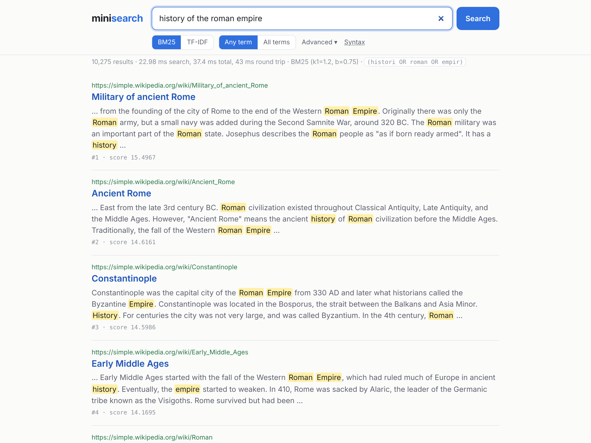

# minisearch

A full-text search engine built from scratch in Python. The analyzer, Porter stemmer, segmented and compressed on-disk inverted index, BM25/TF-IDF ranking, and boolean, phrase and wildcard query engine are all hand-written. No search libraries are used.

> Work in progress. The full README (architecture, benchmarks, evaluation) arrives with the final milestone.

## Quick start

```bash
make install                 # pip install -e ".[dev]"
make data                    # download + convert Simple English Wikipedia (~360 MB)
make index LIMIT=50000       # build an index in indexes/wiki
make serve                   # http://localhost:8000
make test
```


